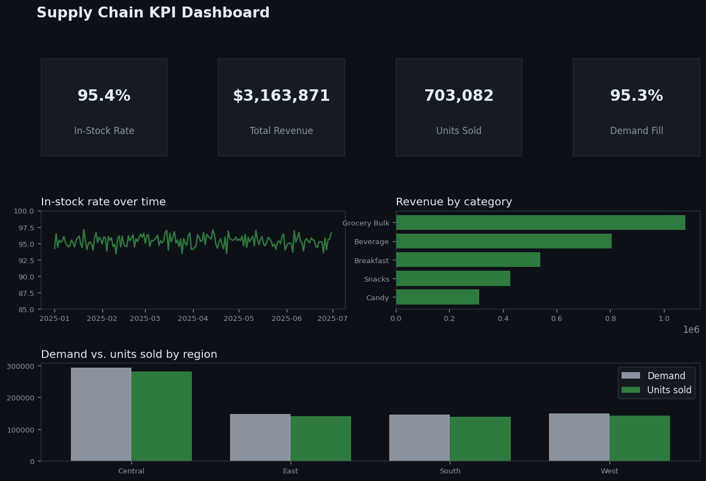

# Supply Chain KPI Dashboard

🔗 Live demo: https://supply-chain-dashboard-vpvl3qyrskqzwuaf8twxri.streamlit.app

An interactive dashboard for the metrics an inventory team watches every day —
in-stock rate, demand vs. units sold, inventory on-hand, and revenue — with
live filters for region, store, category, and date range. Built with Streamlit
and Plotly.

> Runs on fully synthetic data (no real or confidential information) and is
> reproducible end-to-end.



## What it shows

- KPI tiles — In-Stock Rate, Total Revenue, Units Sold, Demand Fill Rate, all
  recomputing live as you change filters.
- In-stock rate over time — a trend line to spot service-level dips.
- Revenue by category — ranked horizontal bars.
- Demand vs. units sold by region — where demand isn't being fully captured.
- Sidebar filters — region, category, and date range, applied across every chart.

## Verified data

The generator produces 4,525 daily store × category rows across 5 stores and 5
categories over 6 months. Sample KPIs from the full dataset:

| KPI | Value |
|---|---|
| In-stock rate | 95.4% |
| Demand fill rate | 95.3% |
| Total revenue | $3,163,871 |
| Units sold | 703,082 |

## Quickstart

```bash
pip install -r requirements.txt
streamlit run app.py        # opens the dashboard; data auto-generates on first load
```

The app generates its synthetic dataset on first load if it isn't present, so it
runs out-of-the-box locally and when deployed — no manual data step.

## Live deployment

This dashboard is deployed free on [Streamlit Community Cloud](https://streamlit.io/cloud):
[supply-chain-dashboard.streamlit.app](https://supply-chain-dashboard-vpvl3qyrskqzwuaf8twxri.streamlit.app).
(Free-tier apps sleep after inactivity and take ~30s to wake — that's expected.)

## Why it's built this way

- Filters drive every view — the sidebar selections flow into one filtered
  dataframe that all four visuals share, so the dashboard stays consistent and
  there's a single source of truth.
- `@st.cache_data` on the loader — the dataset is read once and cached, so
  re-filtering is instant instead of re-reading the file each interaction.
- Operational KPIs, not vanity metrics — in-stock and demand-fill are what an
  inventory team is actually measured on; the dashboard leads with those.

## Repo structure

```
supply-chain-dashboard/
├── app.py                  # Streamlit + Plotly dashboard
├── generate_data.py        # synthetic KPI data generator
├── requirements.txt
├── dashboard_preview.png   # static preview (shown above)
├── data/                   # supply_chain.csv lands here (auto-generated)
└── outputs/                # preview image source
```
